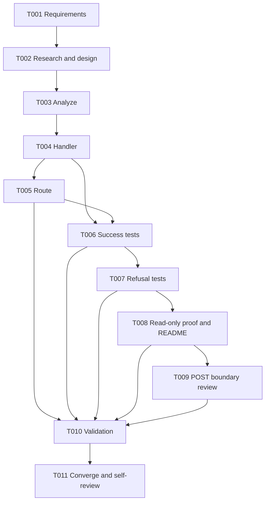

# Tasks: Bill Credit-Source Preview

## Phase 1 — Setup

- [x] T001 Create scoped requirements, specification, and quality checklist in `.specify/specs/credit-source-preview/requirements.md`, `spec.md`, and `checklists/requirements.md`.
  - **Depends on:** —
  - **Acceptance:** Requirements, scenarios, constraints, assumptions, and success criteria are complete; the quality checklist has no unchecked item.
  - **Validation:** Review `.specify/specs/credit-source-preview/checklists/requirements.md`.

## Phase 2 — Foundational research and design

- [x] T002 Research existing credit/store behavior and define design, plan, data model, API contract, and quickstart in `.specify/specs/credit-source-preview/`.
  - **Depends on:** T001.
  - **Acceptance:** Research resolves repository unknowns; design/plan/contract agree with requirements and keep POST unchanged.
  - **Validation:** Cross-check `.specify/specs/credit-source-preview/research.md`, `design.md`, `plan.md`, `data-model.md`, `contracts/credit-source.md`, and `quickstart.md`.
- [x] T003 Analyze requirements, plan, and tasks and resolve inconsistencies in `.specify/specs/credit-source-preview/`.
  - **Depends on:** T002.
  - **Acceptance:** No critical gaps or unaddressed blocking ambiguity remain; tasks cover every functional requirement and buildable success criterion.
  - **Validation:** Review the analysis report; the repository lacks the Spec Kit setup scripts, so the cross-artifact analysis was performed directly.

## Phase 3 — User Story 1 (P1): Prepare a credit request from an eligible bill

**Goal:** Return the exact full remaining amount and all source lines for an eligible bill.

**Independent test criteria:** A bill with no prior credits returns its total and complete lines; a partially credited bill returns exact remaining quantities and amount.

- [x] T004 [US1] Implement `GetBillCreditSource` using existing bill/history queries and note helpers in `pkg/handlers/credit.go`.
  - **Depends on:** T003.
  - **Acceptance:** Return the entire validated remaining amount/lines using `ListBillLinesForNote`, `ListCreditedLinesForBill`, `ListCreditAmountsForBill`, `creditLines`, `checkNoteTotal`, and `creditRemaining`.
  - **Validation:** `rtk go test ./pkg/handlers` compiles and passes existing handler tests.
- [x] T005 [US1] Register authenticated `GET bill/:id/credit-source` in `main.go` without changing `POST bill/credit`.
  - **Depends on:** T004.
  - **Acceptance:** The new route uses the existing authenticated route group; the existing POST route/handler remains unchanged.
  - **Validation:** `rtk go test . ./pkg/handlers`.
- [x] T006 [US1] Add sqlmock tests for no-history and partial-history response values in `pkg/handlers/credit_source_test.go`.
  - **Depends on:** T004 and T005.
  - **Acceptance:** Tests assert exact JSON IDs, string decimals, remaining line quantities, and amount for both histories.
  - **Validation:** `rtk go test ./pkg/handlers -run 'TestGetBillCreditSourceReturns'`.

## Phase 4 — User Story 2 (P1): Refuse unavailable or unprovable credit sources

**Goal:** Fail closed on ineligible bills, unauthorized stores, missing metadata, full credit, or mismatched history.

**Independent test criteria:** Draft/deleted/missing bills, unauthorized store, missing branch/VAT/lines, fully credited bill, unknown credited line, and amount/line mismatches return errors without a usable success payload.

- [x] T007 [US2] Add fail-closed sqlmock cases for full-credit and missing/unverifiable status, branch, VAT, lines, store access, and history in `pkg/handlers/credit_source_test.go`.
  - **Depends on:** T006.
  - **Acceptance:** Each invalid/unverifiable case returns an error and no credit-source payload.
  - **Validation:** `rtk go test ./pkg/handlers -run 'TestGetBillCreditSourceRefuses'`.

## Phase 5 — User Story 3 (P1): Keep the preview non-authoritative

**Goal:** Keep the preview read-only and preserve the POST transaction as the authority.

**Independent test criteria:** Preview reads release their transaction without writes; the existing POST still uses its transactional revalidation path and tests remain unchanged/passing.

- [x] T008 [US3] Verify the GET uses no write expectations and document decimal precision plus stale-preview semantics in `README.md`.
  - **Depends on:** T007.
  - **Acceptance:** The GET only reads and releases its transaction; README documents the route, decimal format, and POST revalidation boundary.
  - **Validation:** Confirm sqlmock expects rollback and no `ExpectExec`; review the README API section.
- [x] T009 [US3] Review handler changes to confirm no bill, credit, stock, or event writes and add a concise stale-preview code comment in `pkg/handlers/credit.go`.
  - **Depends on:** T008.
  - **Acceptance:** Source comment identifies the GET as a non-reserving preview; no POST behavior or transaction code is changed.
  - **Validation:** Review the `pkg/handlers/credit.go` diff around the existing POST and new GET handlers.

## Final Phase — Polish and cross-cutting validation

- [x] T010 Format and validate the endpoint with `rtk gofmt -w pkg/handlers/credit.go pkg/handlers/credit_source_test.go main.go`, `rtk go test ./pkg/handlers -run 'TestGetBillCreditSource'`, and `rtk go test ./pkg/handlers`; record results in `.specify/specs/credit-source-preview/STATUS.md`.
  - **Depends on:** T005, T006, T007, T008, and T009.
  - **Acceptance:** Formatting, focused tests, and package tests pass and results are recorded.
  - **Validation:** Run the listed gofmt and Go test commands.
- [x] T011 Run `/speckit-converge`, self-review the diff and artifacts in `.specify/specs/credit-source-preview/`, and verify only relevant files changed; do not commit or push.
  - **Depends on:** T010.
  - **Acceptance:** Convergence reports no remaining work; final review finds no unrelated files or POST changes; worktree remains uncommitted.
  - **Validation:** Run `rtk git diff --check` and `rtk git status --short`; inspect the final diff.

## Dependencies

### Adjacency list

- T001: —
- T002: T001
- T003: T002
- T004: T003
- T005: T004
- T006: T004, T005
- T007: T006
- T008: T007
- T009: T008
- T010: T005, T006, T007, T008, T009
- T011: T010

## Parallel execution and implementation strategy

- No parallel tasks are assigned. Handler, route, and sqlmock tests belong to one worktree/package and must have one writer; the separate README is still done in sequence here to avoid shared-worktree conflicts.
- **MVP:** Complete User Story 1 with the exact no-history and partial-history responses, while keeping all fail-closed checks required by User Story 2 in the first endpoint implementation.
- User Story 2 and User Story 3 are safety requirements, not optional follow-up behavior; the MVP cannot ship without them.
