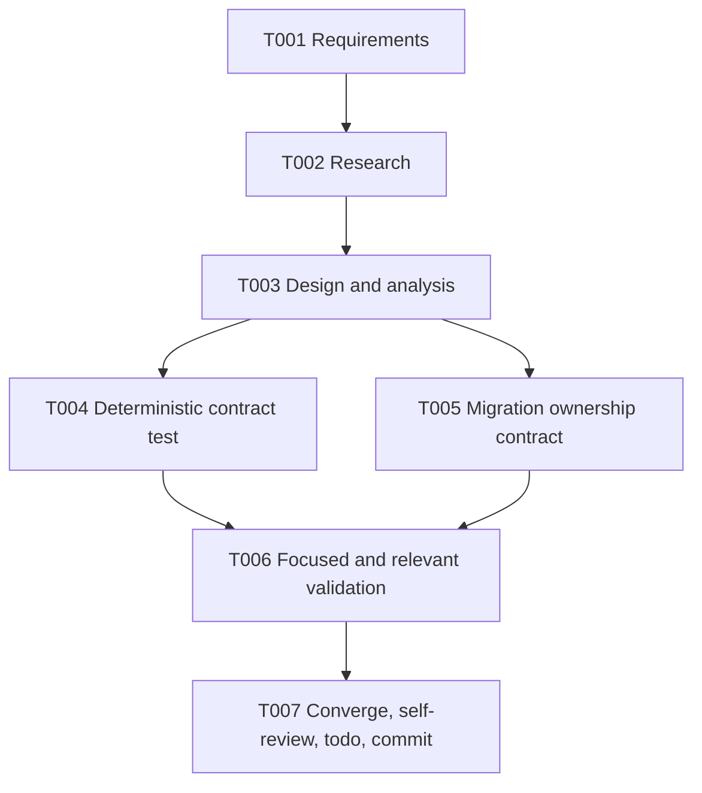

# Tasks: Deterministic EGS Reservation Contract Test

## Phase 1 — Specify and research

- [x] **T001** Create scoped requirements and status artifacts.
  - **Depends on:** —
  - **Acceptance:** Requirements include scope, compatibility, risks, unknowns, and measurable acceptance criteria.
  - **Validation:** Review `requirements.md` and `STATUS.md`.

- [x] **T002** Research the target branch, #105 contract test, removed backend owner, and current daemon `SQLChain`.
  - **Depends on:** T001
  - **Acceptance:** The failure mechanism and authoritative lease semantics are recorded; no blocking unknown remains except environment DSN availability.
  - **Validation:** Review `research.md` against the cited source files and commits.

## Phase 2 — Design and analysis

- [x] **T003** Create design, specification, plan, and quality checklist.
  - **Depends on:** T002
  - **Acceptance:** Artifacts agree on current daemon semantics, deterministic clock, process-isolated DB, test scope, and validation.
  - **Validation:** Review `design.md`, `spec.md`, `plan.md`, and `checklists/requirements.md`.

## Phase 3 — Implementation

- [x] **T004** Add the deterministic Goose EGS reservation contract test in the requested worktree.
  - **Depends on:** T003
  - **Covers:** FR-1, FR-2, FR-3, FR-4; US1/AC1-2, US2/AC1-2, US3/AC1-2
  - **Acceptance:** Fixed UTC clock, explicit expired lease, process-qualified DB name, live busy assertion, expired takeover assertion, stale-owner and chain assertions.
  - **Validation:** `gofmt -w pkg/db/goose/egs_chain_reservation_test.go`; focused Goose test.

- [x] **T005** Align migration ownership documentation and add its contract assertion.
  - **Depends on:** T003
  - **Covers:** FR-5; SC-3
  - **Acceptance:** `00005` and `pkg/db/goose/README.md` name `queue.SQLChain`, do not name removed `pkg/egschain`, and schema SQL is unchanged.
  - **Validation:** `go test ./pkg/db/goose -run 'TestEGSReservationMigrationNamesDaemonOwner|TestMigrationFiles'`; review the Goose README.

## Phase 4 — Validation and convergence

- [x] **T006** Run focused and relevant Go validation.
  - **Depends on:** T004, T005
  - **Covers:** SC-1, SC-2, SC-4
  - **Acceptance:** Focused EGS/goose tests and relevant Go tests pass; any missing MySQL DSN is recorded explicitly.
  - **Validation:** Focused Goose test, `go test ./pkg/db/goose`, `go test ./...`, `go vet ./...`, and `git diff --check`.

- [ ] **T007** Converge, self-review, update evidence/todo, and commit locally.
  - **Depends on:** T006
  - **Covers:** all acceptance criteria and repository constraints
  - **Acceptance:** No remaining scoped tasks or stale status; session todo is done (or blocked with reason); a local commit SHA exists and no push occurred.
  - **Validation:** Review final diff/status, update chat criteria, run the todo SQL, and report `git rev-parse HEAD`.

## Dependencies

## Adjacency list

- T001: —
- T002: T001
- T003: T002
- T004: T003
- T005: T003
- T006: T004, T005
- T007: T006

## Parallel execution

- T004 and T005 are logically independent after T003, but both touch the same Goose
  package/migration boundary in one worktree. Execute them sequentially to avoid
  concurrent writers and simplify review.
