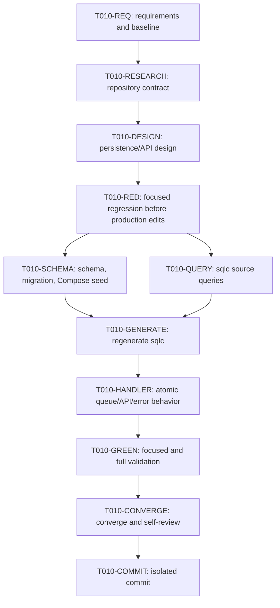

# T010 Dependency-Ordered Tasks

## Dependency graph

## Adjacency list

- T010-REQ: depends on none; unlocks T010-RESEARCH
- T010-RESEARCH: depends on T010-REQ; unlocks T010-DESIGN
- T010-DESIGN: depends on T010-RESEARCH; unlocks T010-RED
- T010-RED: depends on T010-DESIGN; unlocks T010-SCHEMA and T010-QUERY
- T010-SCHEMA: depends on T010-RED; unlocks T010-GENERATE
- T010-QUERY: depends on T010-RED; unlocks T010-GENERATE
- T010-GENERATE: depends on T010-SCHEMA and T010-QUERY; unlocks T010-HANDLER
- T010-HANDLER: depends on T010-GENERATE; unlocks T010-GREEN
- T010-GREEN: depends on T010-HANDLER; unlocks T010-CONVERGE
- T010-CONVERGE: depends on T010-GREEN; unlocks T010-COMMIT

## Tasks

### T010-REQ — Specify requirements and baseline

- **Depends on:** none
- **Deliverable:** `requirements.md`, baseline commit/status evidence.
- **Acceptance:** T003/T026 ancestry and the user scope are recorded.
- **Validation:** `git status --short --branch`; inspect `git log`.
- **Status:** complete.

### T010-RESEARCH — Resolve the existing contract

- **Depends on:** T010-REQ
- **Deliverable:** `research.md` with schema/query/handler/daemon evidence.
- **Acceptance:** state names, API boundary, migration convention, and
  outbox/daemon boundaries are explicit.
- **Validation:** review referenced repository files and dependent contracts.
- **Status:** complete.

### T010-DESIGN — Define persistence and API behavior

- **Depends on:** T010-RESEARCH
- **Deliverable:** `design.md`, `plan.md`, task graph, and traceability.
- **Acceptance:** transaction, failure, compatibility, security, and test
  behavior map to each requirement.
- **Validation:** artifact consistency review.
- **Status:** complete.

### T010-RED — Add and run regression tests first

- **Depends on:** T010-DESIGN
- **Deliverable:** focused tests for queued transition, five visibility states,
  and retry/error persistence.
- **Acceptance:** tests fail against the unchanged T003+T026 production code
  before schema/query/handler implementation edits.
- **Validation:** `rtk go test ./pkg/handlers -run 'TestZatcaOnboardingState' -count=1`.
- **Status:** complete — focused red run captured before production edits
  (0 passed, 8 failed).

### T010-SCHEMA — Add durable schema and migration

- **Depends on:** T010-RED
- **Deliverable:** schema dump, replay-safe `0009` migration, and Docker seed.
- **Acceptance:** current metadata and append-only attempt history are
  represented with indexes/foreign key and compatibility defaults.
- **Validation:** `rtk sqlc generate`; static migration/schema review.
- **Status:** complete.

### T010-QUERY — Add sqlc source contract

- **Depends on:** T010-RED
- **Deliverable:** richer branch projection and guarded queue/progress/error/
  completion/attempt queries.
- **Acceptance:** updates are branch+attempt guarded and API projection has no
  secrets.
- **Validation:** `rtk sqlc generate`; generated methods compile.
- **Status:** complete.

### T010-GENERATE — Regenerate database contracts

- **Depends on:** T010-SCHEMA, T010-QUERY
- **Deliverable:** local ignored sqlc output.
- **Acceptance:** generation succeeds without hand edits.
- **Validation:** `rtk sqlc generate`.
- **Status:** complete.

### T010-HANDLER — Implement backend behavior

- **Depends on:** T010-GENERATE
- **Deliverable:** transactional queue transition, API response/query exposure,
  publisher failure persistence, and strict T026 compatibility.
- **Acceptance:** no duplicate active attempt; queued response; failed retry/error
  visibility; no daemon/frontend/outbox edits.
- **Validation:** focused handler tests and `gofmt`.
- **Status:** complete.

### T010-GREEN — Run required validation

- **Depends on:** T010-HANDLER
- **Deliverable:** exact command evidence for formatting, sqlc, build, vet,
  targeted tests, and `go test ./...`.
- **Acceptance:** pass or precise blocker documented.
- **Validation:** required commands.
- **Status:** complete — build, focused/full tests, gofmt, and sqlc pass;
  vet and live Docker/MySQL migration limitations are documented in STATUS.md.

### T010-CONVERGE — Converge and self-review

- **Depends on:** T010-GREEN
- **Deliverable:** updated `STATUS.md`, README, clean diff review.
- **Acceptance:** artifacts agree; only T010 lane changes remain; schema/migration
  limitations are explicit.
- **Validation:** `git diff --check`, diff/stat/status review.
- **Status:** complete.

### T010-COMMIT — Commit the isolated lane

- **Depends on:** T010-CONVERGE
- **Deliverable:** one commit on `fix/zatca/c5-onboarding-state-backend`.
- **Acceptance:** T003/T026 commits remain ancestors; no push/PR; co-author
  trailer present.
- **Validation:** `git status --short --branch`; `git log -1 --oneline`.
- **Status:** complete — committed as
  `1035557ab51f183a4fe37431c07d7f5831e832e1`; worktree is clean and no push/PR
  was performed.

## Parallelization notes

T010-SCHEMA and T010-QUERY are logically independent after the red test, but
they share sqlc inputs and are being edited in one worktree, so they are
performed serially. No daemon, frontend, or outbox task is parallel-ready in
this lane.
