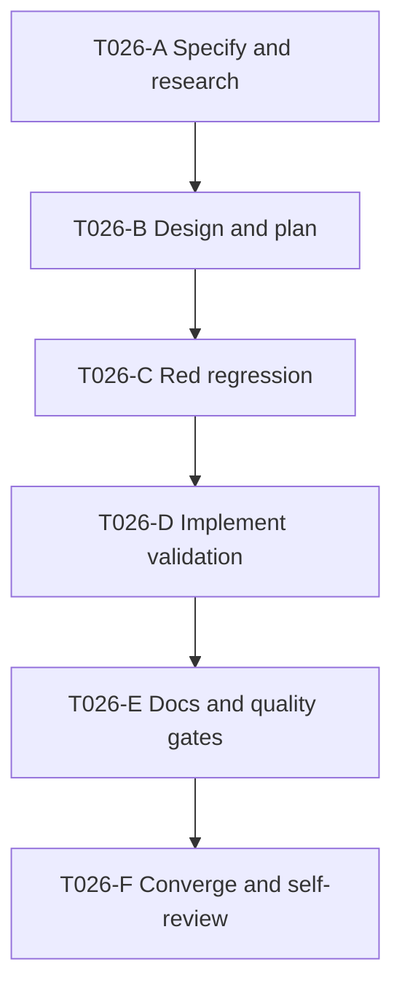

# T026 Tasks

## Dependency-ordered tasks

- [x] **T026-A — Specify and research boundary contract**
  - Depends on: —
  - Deliverable: `requirements.md`, `research.md`, `spec.md`.
  - Acceptance: required fields, risks, existing query, route/error boundaries,
    and unresolved assumptions are recorded.
  - Validation: artifact review.
- [x] **T026-B — Design implementation and validation**
  - Depends on: T026-A
  - Deliverable: `design.md`, `plan.md`, this task graph, `STATUS.md`.
  - Acceptance: implementation flow, error behavior, test strategy, and
    requirement traceability are explicit.
  - Validation: artifact consistency review.
- [x] **T026-C — Add red handler regression**
  - Depends on: T026-B
  - Deliverable: focused sqlmock/recording-publisher test.
  - Acceptance: baseline `9bdb0d6` fails because malformed input reaches the
    publication path; no production implementation edits occur before red.
  - Validation: `go test ./pkg/handlers -run 'TestOnboardBranchZatca'`.
- [x] **T026-D — Implement strict pre-queue validation**
  - Depends on: T026-C
  - Deliverable: pure validators, handler gate, test seam, and green tests.
  - Acceptance: malformed OTP and incomplete/invalid config return actionable
    400 responses without publishing; valid padded OTP publishes trimmed value.
  - Validation: targeted handler test.
- [x] **T026-E — Document and run quality gates**
  - Depends on: T026-D
  - Deliverable: README update, formatted source, full validation evidence.
  - Acceptance: all required tests/tools pass or blockers are recorded.
  - Validation: `gofmt -w ...`; `go test ./pkg/handlers -run 'TestOnboardBranchZatca'`;
    `go test ./...`; `go vet ./...`.
- [x] **T026-F — Converge and self-review**
  - Depends on: T026-E
  - Deliverable: final artifact/status review and one T026-only commit.
  - Acceptance: no stale tasks/risks, no outbox/schema/auth/role changes, and
    commit includes the required co-author trailer.
  - Validation: `git diff --check`, `git diff --stat`, `git status --short`,
    final self-review.

## Dependency graph

## Adjacency list

- T026-A: depends on —
- T026-B: depends on T026-A
- T026-C: depends on T026-B
- T026-D: depends on T026-C
- T026-E: depends on T026-D
- T026-F: depends on T026-E

No tasks are marked parallel because the focused test, handler, artifacts, and
README share the same narrow T026 boundary and must be validated in sequence.
