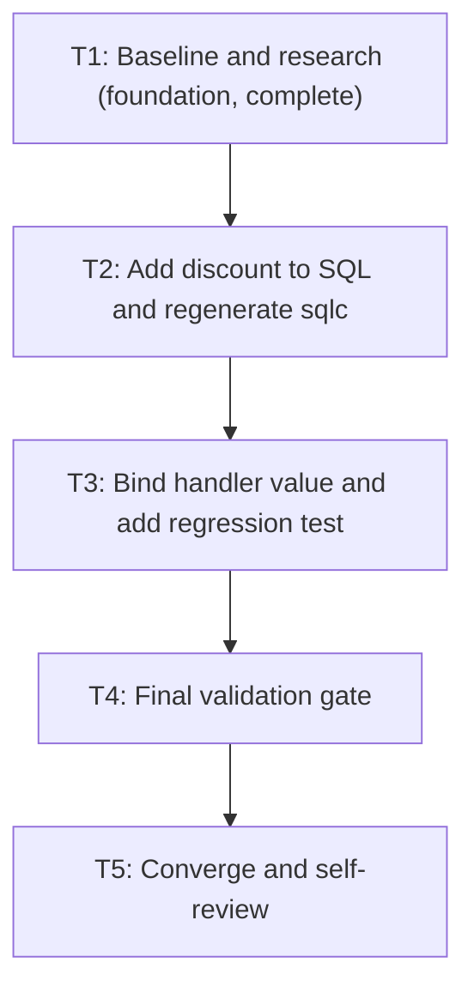

# Tasks: Backend #105 Line-Discount Persistence

## Dependency graph

T1 is the foundational blocker for implementation and is complete. There are no
parallel-ready tasks because the generated query signature is shared by the handler
and test. T4 is the final validation gate; T5 is the convergence and self-review
task.

## Tasks

### T1 - Confirm the baseline and persistence contract [complete]

- **Deliverable**: Verified clean target worktree, existing request/schema/query
  contract, formula, test location, and sqlc availability.
- **Depends on**: None.
- **Acceptance criteria**: Worktree is on `feat/atomic-sale` at the supplied base
  SHA; existing discount column/formula are confirmed; omission is isolated to the
  write path.
- **Validation**: `rtk git status --short --branch`, `rtk git rev-parse HEAD`, and
  source inspection of model, handler, SQL, schema, and tests.

### T2 - Add discount to the insert and regenerate sqlc

- **Deliverable**: `AddProductToBill` inserts the existing line discount and
  generated Go parameters/query include it.
- **Depends on**: T1.
- **Acceptance criteria**: The query binds one discount value; generated output is
  produced by sqlc; generated totals and bill aggregation formulas remain unchanged.
- **Validation**: Run sqlc generation in the target worktree and inspect
  `pkg/db/gen/bill.sql.go`.

### T3 - Bind the request discount and add focused regression coverage

- **Deliverable**: `addProductToBill` passes `BillProduct.Discount`; a handler test
  asserts the non-zero discount in the exact SQL insert arguments.
- **Depends on**: T2.
- **Acceptance criteria**: Test fails if the handler omits or changes the non-zero
  discount argument; unrelated sale SQL mocks remain unchanged.
- **Validation**: Focused test `TestAddProductToBillPersistsLineDiscount` in
  `pkg/handlers`.

### T4 - Run the final validation gate

- **Deliverable**: Formatted changed Go files and passing focused handler tests.
- **Depends on**: T3.
- **Acceptance criteria**: sqlc generation and gofmt complete; focused regression
  and existing sale-write tests pass.
- **Validation**: `rtk gofmt -w` for changed Go files, then
  `rtk go test ./pkg/handlers -run 'TestAddProductToBillPersistsLineDiscount|TestAddBillWritesTheSaleAndItsZatcaEventInOneTransaction|TestAddBillSavesADraftWithoutANumberOrAnEvent'`.

### T5 - Converge and self-review

- **Deliverable**: Final diff and status reviewed against requirements; status
  records validation evidence and any documentation applicability.
- **Depends on**: T4.
- **Acceptance criteria**: Only the scoped feature files in this worktree changed;
  no formula, migration, unrelated mock, commit, or push was introduced.
- **Validation**: `rtk git diff --check`, review `rtk git diff`, and verify
  `rtk git status --short --branch`.

## Adjacency list

- T1: []
- T2: [T1]
- T3: [T2]
- T4: [T3]
- T5: [T4]
