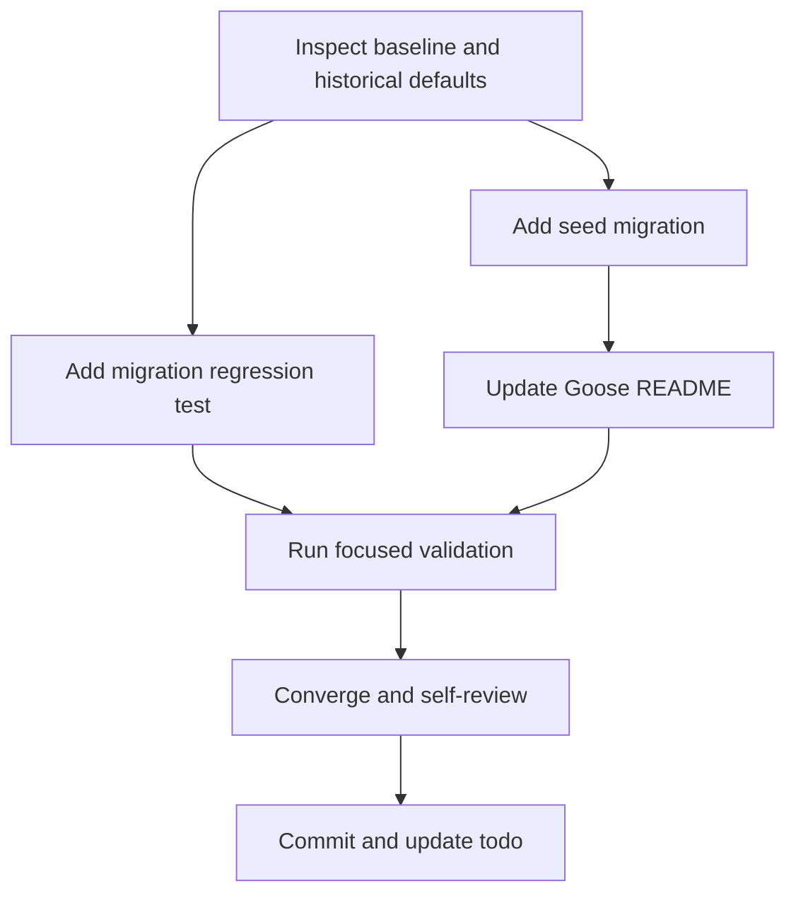

# Tasks: Seed Fresh Tenant Defaults

## Dependency Graph

Adjacency list:

- T001: none
- T002: T001
- T003: T001
- T004: T002
- T005: T002, T003, T004
- T006: T005
- T007: T006

## Phase 1 — Setup

- [x] T001 Inspect the `settings` schema, historical seed values, Goose version sequence, and existing migration test helpers in `pkg/db/goose/` (validation: research evidence recorded in `research.md`)

## Phase 2 — User Story 1: Fresh tenants have usable defaults

- [x] T002 [US1] Add `pkg/db/goose/00011_seed_default_settings.sql` with the six WhatsApp defaults and `default_markup_percentage='20'`, using insert-if-absent semantics and a non-destructive Down section (validation: migration file naming/Up/Down test)
- [x] T003 [P] [US1] Add `pkg/db/goose/settings_test.go` to verify fresh migration values, preservation of existing custom values, and down/up replay idempotency (validation: `rtk go test -count=1 ./pkg/db/goose/...`)

## Phase 3 — User Story 2: Existing tenant configuration is preserved

- [x] T004 [US2] Update `pkg/db/goose/README.md` to document the seeded keys and that rollback preserves settings data (validation: documentation review)

## Phase 4 — Validation and Convergence

- [x] T005 Run focused Goose and handler tests plus `go build ./...`, `go vet ./...`, and `gofmt -l .` from the backend worktree (validation: focused commands pass; repository-wide vet/format output is limited to pre-existing generated/source files; MySQL-backed test may skip only when DSN is absent)
- [x] T006 Review the source diff and all feature artifacts for requirement coverage, stale status, migration safety, and unrelated changes; run convergence checks (validation: no unresolved task or requirement)
- [ ] T007 Commit the verified changes locally and execute `UPDATE todos SET status = 'done' WHERE id = 'seeding-fresh-default-settings';` (validation: clean commit SHA and todo query reports done)

## Parallel Work

- T002 and T003 can be prepared independently after T001, but T003 must test
  the final migration contract before T005.

## Implementation Strategy

Deliver the migration and regression test first, then documentation and the
validation gate. Keep runtime code unchanged.
