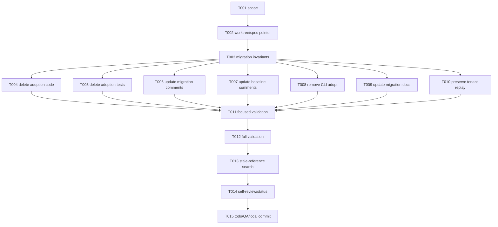

# Tasks: Remove Legacy Database Adoption

## Phase 1: Setup

- [x] T001 Confirm issue #123 scope and review `requirements.md`, `research.md`, `design.md`, `spec.md`, and `plan.md` in `specs/002-remove-legacy-adoption/`.
- [x] T002 Confirm the target worktree is clean and update `.specify/feature.json` to `specs/002-remove-legacy-adoption`.

## Phase 2: Foundational

- [x] T003 Preserve the migration invariants documented in `pkg/db/goose/migrations.go`, `pkg/db/goose/migrations_test.go`, and `.github/workflows/migrations.yml` while making no changes to migration SQL behavior.

## Phase 3: User Story 1 - Provision a fresh tenant

**Goal**: Remove unsupported pre-Goose adoption while retaining the fresh migration path.

**Independent test**: `rtk go test ./pkg/db/goose/...` passes, and the migration files remain exactly `00001` through `00010`.

- [x] T004 [US1] Delete adoption implementation and digest support from `pkg/db/goose/adopt.go`, `pkg/db/goose/schema_digest.go`, and `pkg/db/goose/baseline.digests`.
- [x] T005 [US1] Delete adoption-only parity, regeneration, drift, managed-database, and empty-database tests from `pkg/db/goose/adopt_test.go`.
- [x] T006 [US1] Update `pkg/db/goose/migrations.go` comments to describe the fresh baseline and preserve `BaselineVersion = 1`.
- [x] T007 [US1] Update the baseline header comments in `pkg/db/goose/00001_baseline.sql` without changing any SQL statement or migration numbering.

## Phase 4: User Story 2 - Operate a managed tenant

**Goal**: Keep supported migration CLI commands and rollback safety while removing `migrate adopt`.

**Independent test**: `rtk go build ./...` succeeds and CLI source search finds only `up`, `down`, `roundtrip`, `status`, and `version`.

- [x] T008 [US2] Remove the `adopt` command comment, switch branch, helper, and usage token from `cmd/migrate/main.go`, preserving connection setup and all other commands.
- [x] T009 [US2] Rewrite `pkg/db/goose/README.md` to document fresh-system migration and remove `migrate adopt`, pre-Goose adoption, and adoption-specific CI claims.

## Phase 5: User Story 3 - Use least-privilege tenant credentials

**Goal**: Preserve baseline replay under tenant-local privileges.

**Independent test**: Review `.github/workflows/migrations.yml` and run available MySQL-backed migration tests; the workflow's tenant replay step remains unchanged.

- [x] T010 [US3] Verify `.github/workflows/migrations.yml` tenant replay and `00001_baseline.sql` `DEFINER=CURRENT_USER` behavior remain unchanged apart from stale adoption wording.

## Phase 6: Polish and Cross-Cutting Validation

- [x] T011 Run `rtk go test ./pkg/db/goose/...`, record MySQL-dependent skips if `GOOSE_PARITY_DSN` is absent, and verify migration filenames are contiguous `00001` through `00010`.
- [x] T012 Run `rtk go test ./...`, `rtk go build ./...`, `rtk go vet ./...`, and `rtk gofmt -l .`; fix only failures caused by this change. Full test/build passed; full vet and repository-wide formatting report pre-existing generated/unformatted files, while changed files and non-test vet pass.
- [x] T013 Run scoped searches for `migrate adopt`, `Adopt`, `SchemaDigests`, `BaselineDigests`, `CompareDigests`, `FormatDigests`, `baseline.digests`, and adoption-only wording; leave unrelated image/build digest references unchanged.
- [x] T014 Update `specs/002-remove-legacy-adoption/STATUS.md` with validation evidence and perform final requirements/design/diff self-review.
- [x] T015 Update todo `removing-legacy-adoption` to `done`, record feature-chat acceptance evidence, request designated QA approval if available, and commit all changes locally with the required co-author trailer.

## Dependency Graph

## Adjacency List

- T001 -> none
- T002 -> T001
- T003 -> T002
- T004, T005, T006, T007, T008, T009, T010 -> T003
- T011 -> T004, T005, T006, T007, T008, T009, T010
- T012 -> T011
- T013 -> T012
- T014 -> T013
- T015 -> T014

## Parallel Opportunities

T004 through T010 touch distinct files or deletion units and are logically
independent after T003, but they are intentionally executed serially in this
single worktree to avoid concurrent writers. Validation tasks are sequential
because each depends on the preceding result.

## Implementation Strategy

Complete the fresh-system migration path first (US1), preserve the supported
CLI and tenant safety (US2/US3), then run the full validation gate and commit.
No replacement adoption mechanism is planned.
