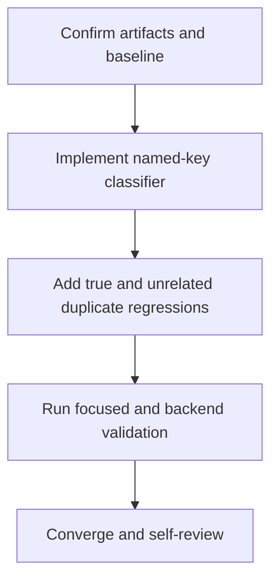

# Tasks

## Dependency graph

T1 is the foundational blocker. T2 and T3 touch the same handler behavior and
are intentionally sequential. T4 is the validation gate; T5 is the final
completion gate.

## Task list

### T1 — Confirming the scoped design

- **Depends on:** None
- **Deliverable:** Requirements, research, design, plan, checklist, and status
  agree on the named request-identity constraint and out-of-scope boundaries.
- **Acceptance:** The actual constraint is recorded as `uq_bill_pos_request`;
  no source has been edited before implementation.
- **Validation:** Review the scoped artifact set and `rtk git status --short`.

### T2 — Implementing named-key sale classification

- **Depends on:** T1
- **Deliverable:** A sale-specific MySQL duplicate predicate is used only by
  the sale update race decision.
- **Acceptance:** Only error 1062 for `uq_bill_pos_request` enters
  `answerLostRace`; other errors retain the current 500 branch.
- **Validation:** `rtk gofmt -w pkg/handlers/bill_sale.go` and focused tests.

### T3 — Adding duplicate-error regressions

- **Depends on:** T2
- **Deliverable:** Existing true-race tests identify the real key, plus a
  regression for an unrelated unique key.
- **Acceptance:** True identity duplicates still replay or conflict; an
  unrelated duplicate returns the existing 500 database-error response rather
  than a conflict or request-identity replay.
- **Validation:** Focused `pkg/handlers` sale tests with `-count=1`.

### T4 — Validating backend behavior

- **Depends on:** T3
- **Deliverable:** Focused tests, backend tests, formatting, and diff checks
  complete with results recorded in `STATUS.md`.
- **Acceptance:** Commands pass, or any environment failure is explicitly
  recorded as a blocker.
- **Validation:** `rtk go test ./pkg/handlers -count=1`, `rtk go test ./...`,
  `rtk gofmt -l .`, and `rtk git diff --check`.

### T5 — Converging and self-reviewing

- **Depends on:** T4
- **Deliverable:** Final source/artifact review confirms only reviewer finding
  #3 changed and no README update is needed for this internal behavior.
- **Acceptance:** No unresolved requirement gaps, stale status, or unreported
  blockers; no commit or push.
- **Validation:** Review `rtk git diff`, `STATUS.md`, and final worktree status.

## Adjacency list

- T1: —
- T2: T1
- T3: T2
- T4: T3
- T5: T4
