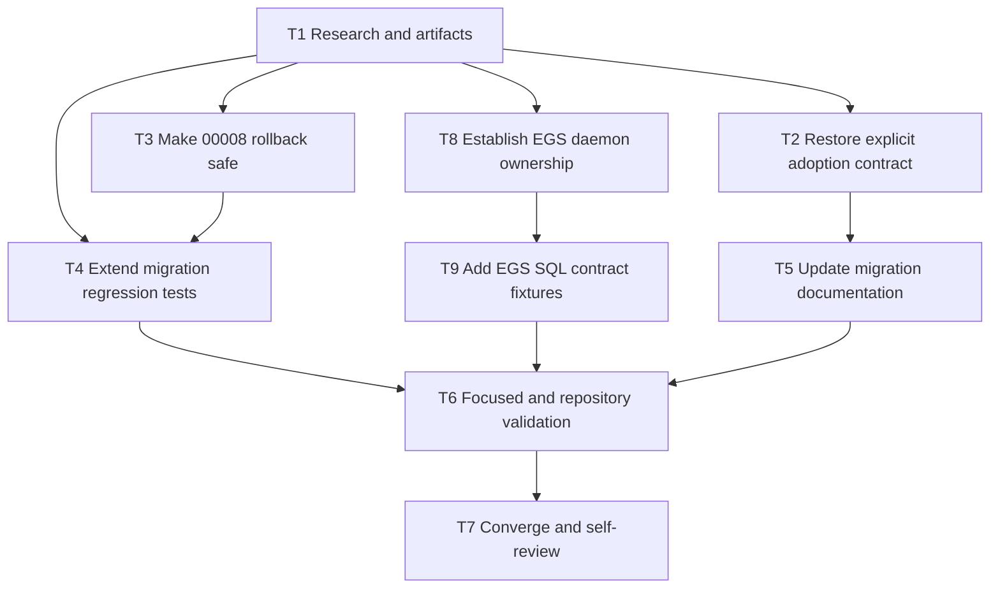

# Tasks: goose migration review fix

## Dependency graph

## Dependency adjacency

- T1: depends on none; validation: review requirements/research artifacts.
- T2: depends on T1; validation: adoption tests and `go test ./pkg/db/goose/...`.
- T3: depends on T1; validation: static Down test and MySQL counter test.
- T4: depends on T1 and T3; validation: focused migration tests.
- T5: depends on T2 and T3; validation: documentation review.
- T6: depends on T4 and T5; validation: gofmt, focused tests, `go test`, `go build`, `go vet`.
- T7: depends on T6; validation: diff/self-review and clean local commit.
- T8: depends on T1; validation: inspect current worktree/history and update 00005 ownership
  comments without changing its applied SQL version.
- T9: depends on T8; validation: MySQL reservation-contract parity test for booking, lease
  takeover, release, commit, and stale re-delivery.

## Work items

### T1 — Establish migration contract [complete]

- **Deliverable:** `requirements.md`, `research.md`, `design.md`, `tasks.md`, and `STATUS.md`.
- **Acceptance:** Source history and current files support preserving 00008 and restoring
  explicit adoption.
- **Validation:** Artifact consistency review.

### T2 — Restore explicit existing-database adoption [complete]

- **Deliverable:** Digest-backed `Adopt` implementation, checked-in baseline digest, command
  entry point, and adoption regression tests.
- **Depends on:** T1.
- **Acceptance:** Empty, drifted, and managed databases are refused; an exact baseline can be
  adopted and then upgraded.
- **Validation:** `go test ./pkg/db/goose/...` with `GOOSE_PARITY_DSN` when available.

### T3 — Making bill-counter rollback non-destructive [complete]

- **Deliverable:** Replace destructive `00008` Down with an explicit safe no-op and document the
  data-backfill rationale.
- **Depends on:** T1.
- **Acceptance:** No Down SQL can delete `branch_sequence`; reapplying Up remains safe.
- **Validation:** static migration test and `TestBillNumberCounter` with MySQL.

### T4 — Extending migration regression coverage [complete]

- **Deliverable:** Fixtures for pre-existing lower/higher counters, null bill sequences,
  unrelated scopes, and post-Down preservation; static Down assertion.
- **Depends on:** T1, T3.
- **Acceptance:** Tests fail against the old destructive behavior and pass with the safe
  contract.
- **Validation:** `go test -run 'TestMigrationFiles|TestBillNumberCounter|TestAdopt' ./pkg/db/goose`.

### T5 — Updating migration documentation [complete]

- **Deliverable:** README describes fresh/managed `up`, explicit `adopt`, and non-reversible
  data backfill.
- **Depends on:** T2, T3.
- **Acceptance:** Operators are not told to silently run `up` against an arbitrary existing
  schema.
- **Validation:** Documentation review.

### T6 — Running validation gates [complete with environment blocker]

- **Deliverable:** Focused tests plus available full package/repository build, vet, and format
  checks.
- **Depends on:** T4, T5.
- **Acceptance:** Commands pass or remaining environment blockers are recorded.
- **Validation:** `gofmt -l`, `go test`, `go build`, and `go vet`.

### T8 — Establishing EGS daemon ownership [complete]

- **Deliverable:** Migration 00005 comments and migration README identify `queue.SQLChain` in the
  external ZATCA daemon as the sole owner; no stale backend-owner reference remains.
- **Depends on:** T1.
- **Acceptance:** No removal migration is added without evidence that the external daemon no
  longer uses the columns; applied numbering remains unchanged.
- **Validation:** `rg 'pkg/egschain|icv_reservation' pkg/db/goose pkg/db/queries`.

### T9 — Verifying EGS reservation SQL contract [complete with environment blocker]

- **Deliverable:** MySQL parity fixture covering concurrent booking/locking, same-key
  re-delivery, lease takeover, release, commit, and stale-owner rejection.
- **Depends on:** T8.
- **Acceptance:** The four reservation columns remain all-or-none and owner guards prevent
  stale operations from changing the chain.
- **Validation:** `go test -run TestEGSReservationContract ./pkg/db/goose` with
  `GOOSE_PARITY_DSN`.

### T7 — Converging and committing [complete]

- **Deliverable:** Self-reviewed local commit and final evidence.
- **Depends on:** T6.
- **Acceptance:** No version renumbering, no remote writes, clean commit SHA recorded, QA
  approval requested/received where available.
- **Validation:** `git diff --check`, `git status`, commit inspection, QA gate.
