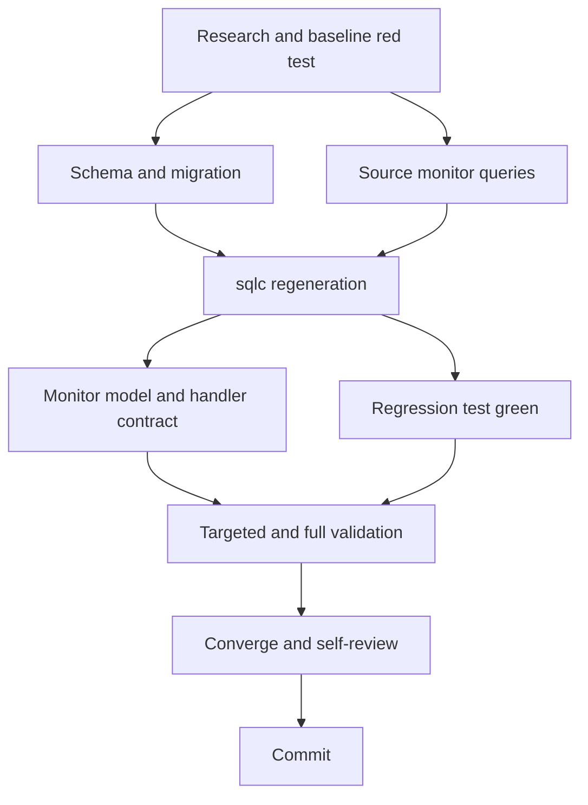

# T003 Tasks

## Dependency Graph

## Dependency-Ordered Tasks

### T003A - Baseline and specification (done)

- **Deliverable**: requirements/spec/research/design artifacts and a focused
  regression test that fails on `9bdb0d6`.
- **Depends on**: none.
- **Acceptance**: exact red evidence captured; no production schema/query
  change was made before the red run.
- **Validation**: `go test ./pkg/db -run '^TestZatcaMonitorReturnsProviderOutcome$' -count=1`.

### T003B - Adding durable ZATCA schema and migration

- **Deliverable**: additive schema dump changes, replay-safe migration, child
  outcome/attempt/artifact tables, indexes, and Docker seed registration.
- **Depends on**: T003A.
- **Acceptance**: six states, stable document identity, provider/retry/artifact
  fields, timestamps, foreign keys, and tenant-preserving indexes exist.
- **Validation**: `sqlc generate`; inspect migration with the repository's MySQL
  syntax/parser and run targeted schema contract checks.

### T003C - Updating tenant-safe monitor source queries

- **Deliverable**: stats, branch, and submission monitor queries read explicit
  outcome state/provider/retry/artifact data and apply merchant scope.
- **Depends on**: T003A.
- **Acceptance**: no document-level monitor query can return another tenant's
  bill; explicit state is preferred to legacy numeric status.
- **Validation**: `sqlc generate` and the regression test's SQL mock contract.

### T003D - Regenerating sqlc contracts

- **Deliverable**: generated local database contracts from source schema/query
  inputs using `sqlc generate`; no generated file is hand-edited.
- **Depends on**: T003B, T003C.
- **Acceptance**: generated query methods/types compile and match source
  columns; ignored generated output is reproducible.
- **Validation**: `sqlc generate` followed by `go build ./...`.

### T003E - Updating monitor model and handler contract

- **Deliverable**: explicit state/provider/retry/artifact response fields,
  tenant argument wiring, and backwards-compatible legacy mapping.
- **Depends on**: T003D.
- **Acceptance**: existing monitor endpoints remain mounted and return explicit
  state data without exposing cross-tenant rows.
- **Validation**: targeted handler/db tests and `go vet ./...`.

### T003F - Making the regression green

- **Deliverable**: the pre-existing red regression test passes after source and
  generated contracts are updated.
- **Depends on**: T003D.
- **Acceptance**: provider state is `accepted_with_warning`, provider code and
  warning code are present in the generated monitor row.
- **Validation**: `go test ./pkg/db -run '^TestZatcaMonitorReturnsProviderOutcome$' -count=1`.

### T003G - Running validation gates

- **Deliverable**: formatted, generated, built, vetted, targeted-tested, and
  full-tested worktree.
- **Depends on**: T003E, T003F.
- **Acceptance**: requested commands pass or precise blockers are recorded.
- **Validation**: gofmt, sqlc generate, targeted tests, `go build ./...`,
  `go vet ./...`, and `go test ./...`.

### T003H - Converging and self-reviewing

- **Deliverable**: requirements/design/tasks/status consistency review,
  README update, and final diff review with no out-of-scope changes.
- **Depends on**: T003G.
- **Acceptance**: no unresolved requirement gap or stale status claim.
- **Validation**: inspect `git diff --check`, `git diff`, and feature artifacts.

### T003I - Committing PR-ready changes

- **Deliverable**: concise commit on `fix/zatca/c2-submission-state-backend`.
- **Depends on**: T003H.
- **Acceptance**: clean worktree except the commit, no push/PR, no other
  worktree changed.
- **Validation**: `git status --short --branch` and `git log -1 --oneline`.

## Adjacency List

- T003A: none
- T003B: T003A
- T003C: T003A
- T003D: T003B, T003C
- T003E: T003D
- T003F: T003D
- T003G: T003E, T003F
- T003H: T003G
- T003I: T003H

## Parallelization Notes

T003B and T003C are marked logically independent after T003A, but they are
implemented in one worktree and must not be edited concurrently because sqlc
parses both inputs together. T003D is the foundational blocker for contract
updates. T003G is the final validation gate.
