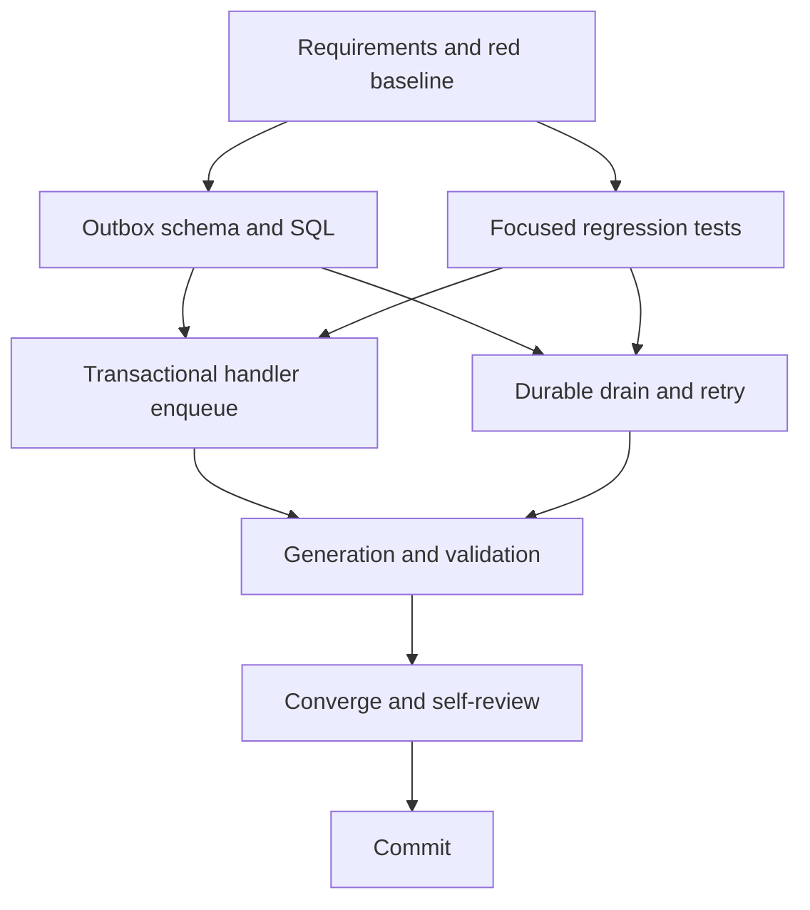

# T007 Tasks

## Dependency Graph

## Dependency-Ordered Tasks

### T007A - Specifying and researching transactional publication (done)

- **Deliverable**: requirements, research, design, plan, status, and a
  documented base red command.
- **Depends on**: none.
- **Acceptance**: scope excludes frontend/daemon/deployment and records
  migration/runtime constraints.
- **Validation**: inspect artifacts; run the exact focused red command.

### T007B - Adding durable outbox schema and sqlc queries

- **Deliverable**: additive migration/schema table, indexes, lifecycle states,
  and generated-source queries for enqueue/claim/success/failure.
- **Depends on**: T007A.
- **Acceptance**: fresh and existing databases can create the table without
  changing business rows; queries support due rows and stale claims.
- **Validation**: `sqlc generate` and source migration review.

### T007C - Adding red transaction and failure regressions

- **Deliverable**: focused sqlmock/handler tests that demonstrate pre-commit
  publication and ignored errors on the baseline.
- **Depends on**: T007A.
- **Acceptance**: tests fail at `fc084a4` for the requested reasons.
- **Validation**: exact `go test` commands recorded in STATUS.

### T007D - Enqueuing all in-scope handlers transactionally

- **Deliverable**: bill, credit, debit entry point, and onboarding use the
  outbox insert before commit and never publish from the open transaction.
- **Depends on**: T007B, T007C.
- **Acceptance**: business mutation and outbox insert commit/rollback together.
- **Validation**: focused handler sqlmock tests.

### T007E - Draining, retrying, and recording failures

- **Deliverable**: post-commit drainer, bounded backoff, stale-claim recovery,
  publisher lifecycle integration, and durable status transitions.
- **Depends on**: T007B, T007C.
- **Acceptance**: NATS success marks published; NATS failure persists error and
  next retry; restart can drain the row.
- **Validation**: focused drainer tests plus build/vet.

### T007F - Regenerating and running validation gates

- **Deliverable**: formatted backend source, generated contracts, build/vet,
  targeted green tests, and full suite.
- **Depends on**: T007D, T007E.
- **Acceptance**: all available commands pass or exact unavailable runtime is
  recorded.
- **Validation**: gofmt, sqlc, build, vet, targeted tests, `go test ./...`.

### T007G - Converging and self-reviewing

- **Deliverable**: README update, artifact consistency, diff/scope review, and
  migration concerns.
- **Depends on**: T007F.
- **Acceptance**: no frontend/daemon/deployment changes and no stale status.
- **Validation**: `git diff --check`, diff inspection, artifact review.

### T007H - Committing only the lane

- **Deliverable**: one local commit on `fix/zatca/c4-transactional-outbox`.
- **Depends on**: T007G.
- **Acceptance**: commit contains only T007 backend/spec changes; no push/PR.
- **Validation**: `git status --short --branch`, `git show --stat --oneline HEAD`.

## Adjacency List

- T007A: none
- T007B: T007A
- T007C: T007A
- T007D: T007B, T007C
- T007E: T007B, T007C
- T007F: T007D, T007E
- T007G: T007F
- T007H: T007G

## Parallelization Notes

T007B and T007C are logically independent after T007A, but this isolated
worktree uses one writer. T007D and T007E share generated SQL contracts and
must converge before generation/validation.
