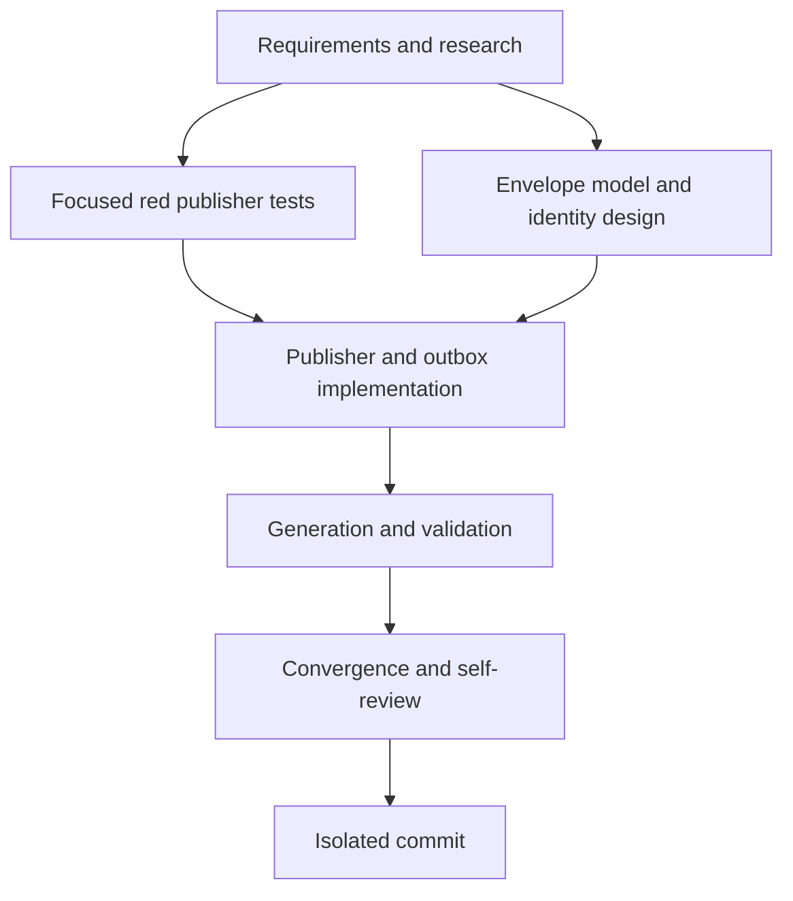

# T014 Tasks

## Dependency Graph

## Dependency-Ordered Tasks

### T014A - Specify and research the envelope (done)

- **Deliverable**: requirements, research, design, plan, data model,
  contract, quickstart, tasks, and status artifacts.
- **Depends on**: none.
- **Acceptance**: all known questions are resolved or explicitly bounded;
  daemon/business-state scope is excluded.
- **Validation**: artifact review.

### T014B - Add focused red publisher regressions

- **Deliverable**: capturing JetStream tests that reject the T007
  five-field/non-deterministic payload.
- **Depends on**: T014A.
- **Acceptance**: the tests fail at `d4069f4` for missing versioned identity,
  missing envelope fields, or missing deterministic `Nats-Msg-Id`.
- **Validation**: targeted `go test` command and recorded red output.

### T014C - Define envelope and deterministic identity [P]

- **Deliverable**: source-compatible message fields, normalization helpers,
  stable EGS fallback, and stable-key message-ID helper.
- **Depends on**: T014A.
- **Acceptance**: old aliases remain available; equal durable input yields equal
  stable key and NATS identity.
- **Validation**: focused unit tests.

### T014D - Integrate committed outbox context

- **Deliverable**: row-aware publication that adds outbox ID and attempt
  metadata without changing persistence or business state.
- **Depends on**: T014B, T014C.
- **Acceptance**: row ID and 1-based attempt metadata are present; retry keeps
  stable key/message ID; old aliases and subject remain unchanged.
- **Validation**: focused outbox publisher tests and existing T007 tests.

### T014E - Regenerate and run validation gates

- **Deliverable**: formatted code, regenerated sqlc output, build/vet/test
  evidence.
- **Depends on**: T014D.
- **Acceptance**: sqlc, gofmt, build, vet, targeted tests, and full suite pass,
  or exact pre-existing blockers are recorded.
- **Validation**: commands in `STATUS.md`.

### T014F - Converge and self-review

- **Deliverable**: README update, diff/scope review, and consistent artifacts.
- **Depends on**: T014E.
- **Acceptance**: no daemon/reconciliation/business-state changes; no stale
  status; requirements/design/tasks map to implementation.
- **Validation**: `git diff --check`, diff inspection, artifact review.

### T014G - Commit isolated changes

- **Deliverable**: one local T014 commit on
  `fix/zatca/h2-event-idempotency-envelope`.
- **Depends on**: T014F.
- **Acceptance**: only T014 backend/tests/docs/spec artifacts are committed;
  no push or PR.
- **Validation**: `git status --short --branch`, `git show --stat --oneline`.

## Adjacency List

- T014A: none
- T014B: T014A
- T014C: T014A
- T014D: T014B, T014C
- T014E: T014D
- T014F: T014E
- T014G: T014F

## Parallelization Notes

T014B and T014C are logically independent after T014A, but this isolated
worktree uses one writer. T014D must wait for both because tests and the
envelope shape converge in the same publisher boundary.
