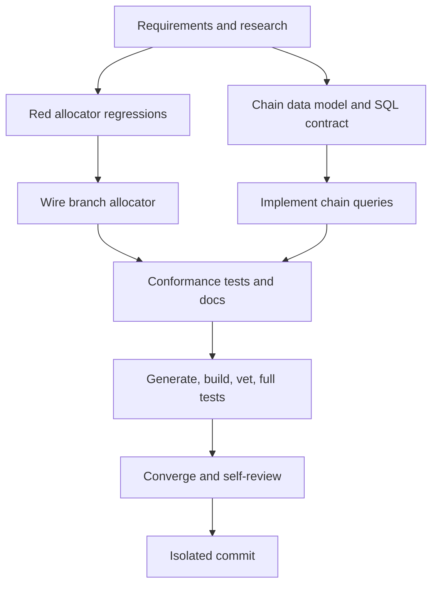

# T016 Tasks

## Dependency Graph

## Dependency-Ordered Tasks

### T016A — Specify and research (done)

- **Deliverable**: requirements, research, design, data model, contract,
  quickstart, plan, tasks, and status artifacts.
- **Depends on**: none.
- **Validation**: artifact consistency review.

### T016B — Add focused red regressions

- **Deliverable**: sqlmock/concurrency tests that expect branch allocation and
  fail against the current global-max handler.
- **Depends on**: T016A.
- **Acceptance**: baseline test output is red for the missing allocator query.
- **Validation**: targeted `go test` command recorded in `STATUS.md`.

### T016C — Define chain ownership contract [P]

- **Deliverable**: T016 migration design, sqlc query shapes, and daemon
  contract for branch/EGS reserve/commit/release.
- **Depends on**: T016A.
- **Acceptance**: tenant, branch, EGS, stable key, owner token, ICV, PIH,
  lease, and rollback semantics are explicit.
- **Validation**: contract/data-model review.

### T016D — Wire branch invoice allocator

- **Deliverable**: replace global max calls in posted bill paths with the
  existing atomic `AllocateBranchSequence` query and propagate failures.
- **Depends on**: T016B.
- **Acceptance**: no posted path calls `GetMaxSequenceNumber`; branch ID and
  `bill` scope are passed inside the existing transaction.
- **Validation**: targeted handler tests and generated SQL.

### T016E — Implement chain persistence queries [P]

- **Deliverable**: additive schema/migration and sqlc reserve/commit/release
  queries.
- **Depends on**: T016C.
- **Acceptance**: fixed parameterized queries use branch/EGS/owner predicates
  and support idempotent same-key recovery.
- **Validation**: sqlc generation and sqlmock query tests.

### T016F — Conformance tests and documentation

- **Deliverable**: ownership/error/rollback tests and README contract note.
- **Depends on**: T016D, T016E.
- **Acceptance**: T014 envelope/outbox behavior remains unchanged and live
  MySQL limitation is explicit.
- **Validation**: focused test suite and diff review.

### T016G — Required validation

- **Deliverable**: sqlc, gofmt, build, vet, targeted tests, full tests, and
  exact evidence.
- **Depends on**: T016F.
- **Validation**: commands in `STATUS.md`.

### T016H — Converge and self-review

- **Deliverable**: reconcile artifacts against implementation; inspect scope,
  security, generated output, and documentation.
- **Depends on**: T016G.
- **Validation**: `git diff --check`, status review, no daemon/debit changes.

### T016I — Isolated commit

- **Deliverable**: one local PR-ready T016 commit, no push/PR.
- **Depends on**: T016H.
- **Validation**: clean status and commit stat.

## Adjacency List

- T016A: none
- T016B: T016A
- T016C: T016A
- T016D: T016B
- T016E: T016C
- T016F: T016D, T016E
- T016G: T016F
- T016H: T016G
- T016I: T016H

## Parallelization Notes

T016B and T016C are logically independent after the artifacts are written.
They are kept sequential in this worktree to avoid two writers touching the
same SQL/test boundaries.
