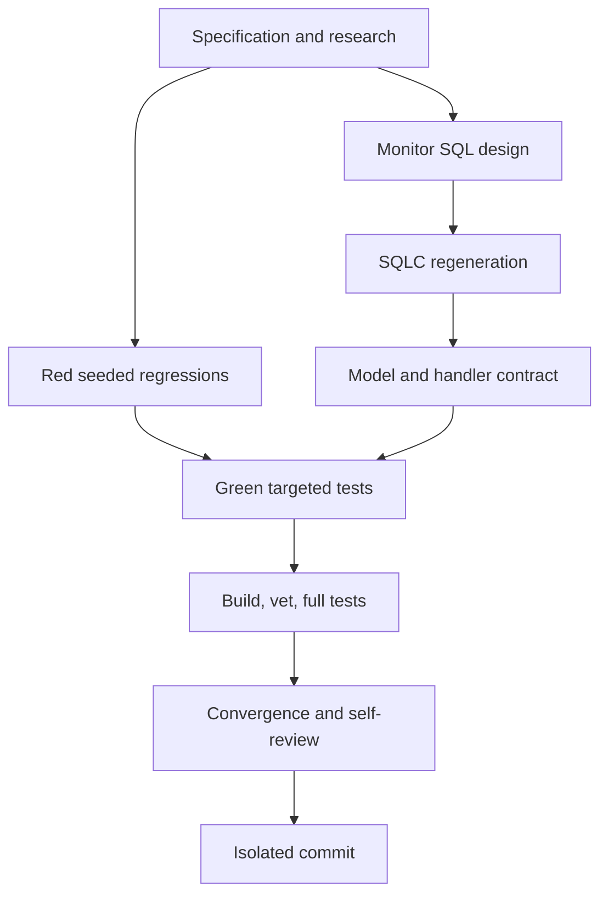

# T022 Tasks

## Dependency Graph

## Dependency-Ordered Tasks

### T022A - Specify and research the monitor fix (done)

- **Deliverable**: requirements, research, design, plan, spec, checklist, and
  status artifacts for this scoped backend change.
- **Depends on**: none.
- **Acceptance**: requirements and design explicitly prohibit fabricated
  fallback and preserve API/auth/out-of-scope boundaries.
- **Validation**: inspect artifacts for consistency and traceability.

### T022B - Add red seeded SQL and handler regressions

- **Deliverable**: deterministic sqlmock tests seeded with tenant/branch,
  outcome, attempt, pending-age, and provider data.
- **Depends on**: T022A.
- **Acceptance**: tests fail against the T003 monitor projections because
  aggregate or handler fields are missing/mismatched, without weakening the
  assertions.
- **Validation**: `rtk go test ./pkg/db ./pkg/handlers -run 'T022|ZatcaMonitor' -count=1`.

### T022C - Update durable monitor source SQL

- **Deliverable**: tenant/branch aggregate and submission queries with complete
  state counts, pending age, latest attempt state, and provider evidence.
- **Depends on**: T022A.
- **Acceptance**: no literal state/provider/retry fallback manufactures a row;
  both tenant predicates remain; branches without durable submissions are
  excluded.
- **Validation**: `rtk sqlc generate`.

### T022D - Regenerate sqlc contracts

- **Deliverable**: generated local query types matching source SQL.
- **Depends on**: T022C.
- **Acceptance**: generation succeeds and generated query methods compile.
- **Validation**: `rtk sqlc generate; rtk go build ./...`.

### T022E - Update model and handler contracts

- **Deliverable**: additive response fields and nullable durable mapping while
  preserving route/filter/auth behavior.
- **Depends on**: T022D.
- **Acceptance**: provider/retry/pending fields come from query rows; no
  fabricated optional values; legacy fields remain.
- **Validation**: targeted handler tests and `rtk go vet ./...`.

### T022F - Make focused regressions green

- **Deliverable**: all seeded SQL and handler tests pass after implementation.
- **Depends on**: T022B, T022E.
- **Acceptance**: tests prove real seeded rows are required and verify tenant
  isolation and nullable evidence.
- **Validation**: `rtk go test ./pkg/db ./pkg/handlers -run 'T022|ZatcaMonitor' -count=1`.

### T022G - Run validation gates

- **Deliverable**: formatted, generated, built, vetted, targeted-tested, and
  full-tested worktree.
- **Depends on**: T022F.
- **Acceptance**: all requested validation commands pass.
- **Validation**: `rtk gofmt -l .; rtk go build ./...; rtk go vet ./...; rtk go test ./...`.

### T022H - Converge and self-review

- **Deliverable**: updated README/status, clean diff-check, and artifact/code
  consistency review.
- **Depends on**: T022G.
- **Acceptance**: no out-of-scope files, stale status, unresolved requirements,
  or generated SQL drift.
- **Validation**: `rtk git diff --check; rtk git status --short;` inspect diff.

### T022I - Commit isolated PR-ready changes

- **Deliverable**: one commit on `fix/zatca/h8-monitor-api`.
- **Depends on**: T022H.
- **Acceptance**: required co-author trailer, no push/PR, clean post-commit
  worktree.
- **Validation**: `rtk git log -1 --format=fuller; rtk git status --short --branch`.

## Adjacency List

- T022A: none
- T022B: T022A
- T022C: T022A
- T022D: T022C
- T022E: T022D
- T022F: T022B, T022E
- T022G: T022F
- T022H: T022G
- T022I: T022H

T022B and T022C are logically independent after T022A, but they share the
same worktree and must be applied sequentially. T022D is the generated-contract
blocker. T022G is the final validation gate.
