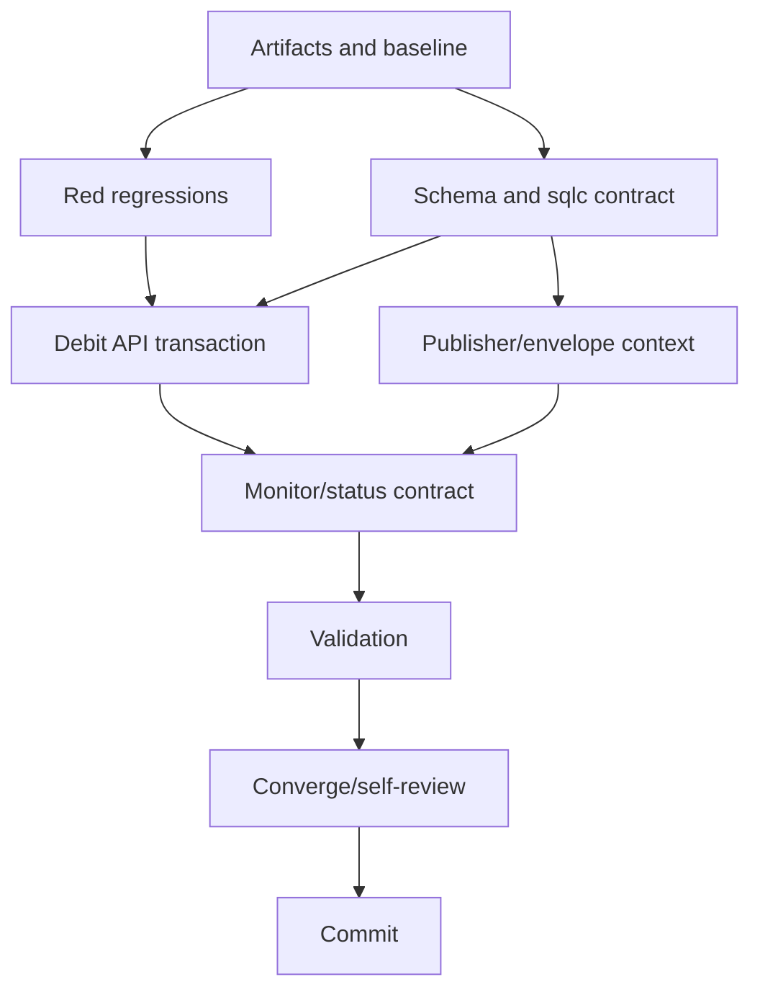

# T024 Tasks

## Dependency Graph

## Phase 1 — Setup

- [x] T001 Create T024 requirements, research, design, spec, plan, data model, API/event contracts, quickstart, checklist, and status artifacts in `specs/024-debit-note-domain/`

## Phase 2 — Foundational

- [x] T002 Add focused red regressions for the missing debit API/source, contextual publisher envelope, and monitor source fields in `pkg/handlers/zatca_debit_regression_test.go`
- [x] T003 [P] Add replay-safe debit source and generic submission migrations/schema in `pkg/db/migrations/0011_zatca_debit_note.sql`, `pkg/db/migrations/0012_zatca_submission_sources.sql`, and `pkg/db/schema/schema.sql`; include tenant/source uniqueness, parent/branch links, sequence/EGS context, and historical submission backfill

## Phase 3 — User Story 1: Authenticated durable debit creation (P1)

**Goal**: An authenticated tenant user can create one parent-linked debit
source, pending submission, and outbox event in one transaction.

**Independent test criteria**: The debit handler test observes the merchant-safe
parent lookup, source/identity/submission/outbox writes, commit-before-wake
ordering, and no pre-commit publisher call; unauthorized and duplicate
parents fail without durable writes.

- [x] T004 [US1] Add sqlc debit source/context/submission queries in `pkg/db/queries/debit.sql` with positive IDs, merchant predicates, parent `FOR UPDATE`, EGS fallback, stable identity finalization, and idempotent pending submission registration
- [x] T005 [US1] Implement the authenticated `POST /api/v2/bill/debit` transaction in `pkg/handlers/debit.go` and mount it in `main.go`; derive merchant/branch/sequence/EGS from the authorized parent and preserve existing error/commit behavior

## Phase 4 — User Story 2: Stable debit publication context (P1)

**Goal**: A debit outbox event retains durable source identity, tenant/branch,
sequence, and EGS context across publication retries.

**Independent test criteria**: The publisher regression decodes the outbox
envelope and sees the same debit source ID, stable key, sequence, and EGS
identity without a direct NATS call during enqueue.

- [x] T006 [US2] Extend `Message` and contextual outbox construction in `pkg/handlers/zatca_envelope.go` and `pkg/handlers/zatca_outbox.go`; make `EnqueueDebit` load the durable context from the caller transaction and retain existing bill/credit/onboarding identity behavior

## Phase 5 — User Story 3: Monitor-visible debit outcome (P1)

**Goal**: Existing monitor routes expose debit source identity/context and
pending/provider outcome without weakening tenant isolation.

**Independent test criteria**: The monitor regression scans a debit row with
document kind/source/sequence/EGS/stable key and existing explicit outcome
fields; another merchant's row remains excluded by SQL predicates.

- [x] T007 [US3] Extend monitor source SQL and response mapping in `pkg/db/queries/zatca_monitor.sql`, `pkg/handlers/zatca_monitor.go`, and `pkg/model/zatca_monitor.go` with additive document/source/sequence/EGS/stable-key fields and preserved tenant filters

## Phase 6 — Polish and cross-cutting validation

- [x] T008 Regenerate ignored sqlc output, format changed Go files, and run focused handler/database tests from `specs/024-debit-note-domain/quickstart.md`
- [x] T009 Run `rtk go build .`, `rtk go vet ./...`, `rtk go test ./... -count=1`, and `rtk git diff --check`; record results and live MySQL limitation in `specs/024-debit-note-domain/STATUS.md`
- [x] T010 Update the ZATCA debit/source/monitor contract note in `README.md` without documenting daemon processing or import persistence
- [ ] T011 Reconcile requirements/design/tasks/status against the final diff, verify no daemon/frontend/import files changed, and perform security/tenant/generated-SQL self-review
- [ ] T012 Create one isolated local commit for T024 with the required co-author trailer; do not push or create a PR

## Dependencies

- T001: none
- T002: T001
- T003: T001
- T004: T002, T003
- T005: T004
- T006: T003
- T007: T005, T006
- T008: T007
- T009: T008
- T010: T007
- T011: T009, T010
- T012: T011

## Parallel execution examples

- T003 and the red baseline evidence in T002 are independent after T001.
- T006 can be implemented independently after T003, while T004/T005 own the
  API query/handler files.
- T008/T009/T010 must wait for implementation and must not run as concurrent
  writers.

## Implementation strategy

Deliver the smallest complete vertical slice: source schema/query and
authenticated transaction first, then durable publisher context, then monitor
read additions. Keep daemon XML/provider/import work explicitly deferred.
