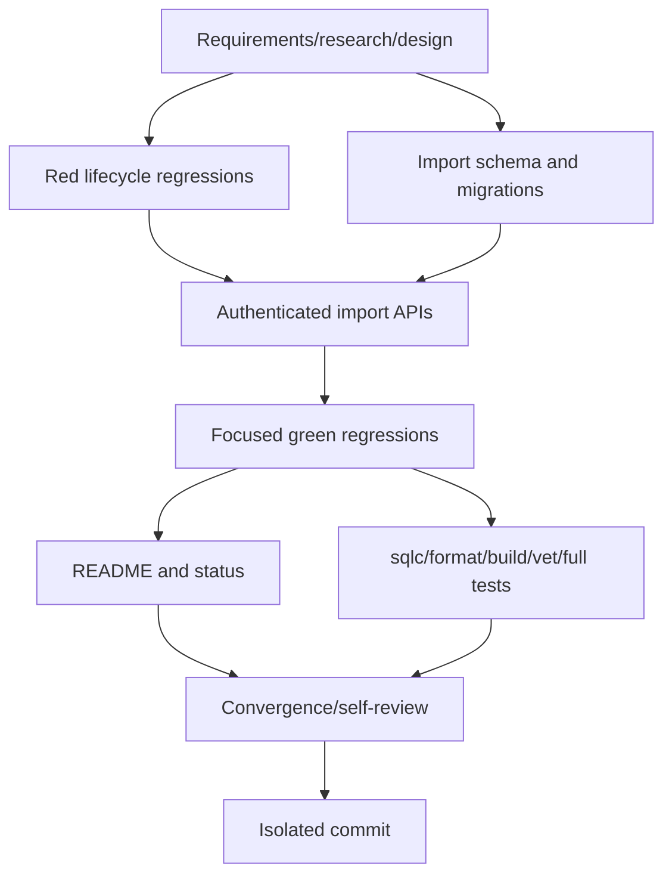

# T031 tasks

## Dependency graph

## Dependency-ordered tasks

### Phase 1 — Artifacts and red baseline

- [x] **T031-REQ** Create requirements, research, design, plan/spec, tasks,
  and status artifacts. Validation: artifact consistency review.
- [x] **T031-RED** Add focused handler/sqlmock lifecycle regressions for
  create evidence, tenant-safe detail, review approval, post, reject, and
  absence of outbound writes. Validation: targeted tests fail on `98ae215`
  because no durable import API/record exists.

### Phase 2 — Persistence foundation

- [x] **T031-SCHEMA** Add replay-safe `0013_zatca_signed_ubl_import.sql`,
  checked-in schema definitions, and `zatca_import.sql` sqlc queries for job,
  evidence, validation issues, review decisions, status history, and guarded
  reads/transitions. Validation: `sqlc generate` and SQL review.

### Phase 3 — Authenticated lifecycle API

- [x] **T031-API** Add T030-compatible request/response models and handlers;
  mount authenticated create/list/detail/review/post/reject routes. Validate
  bytes/hash/source metadata, persist immutable evidence and issues
  transactionally, enforce tenant/version/status predicates, and never write
  outbound submission/outbox state. Validation: focused handler regressions.

### Phase 4 — Completion

- [x] **T031-GREEN** Run focused import lifecycle tests and existing ZATCA
  regressions. Validation: targeted `go test`.
- [x] **T031-DOC** Update README with the import persistence/API boundary and
  explicit no-daemon/no-outbound-submission scope. Validation: diff review.
- [x] **T031-VALIDATE** Run `sqlc generate`, `gofmt`, `go build .`,
  `go vet ./...`, `go test ./... -count=1`, and `git diff --check`. Record
  live MySQL/storage limitations in STATUS. Validation: command output.
- [x] **T031-CONVERGE** Reconcile artifacts with final diff, verify frontend
  and daemon are untouched, and perform security/tenant/generated-SQL
  self-review. Validation: convergence checklist.
- [ ] **T031-COMMIT** Create one isolated local commit with the required
  co-author trailer; do not push or create a PR. Validation: status/log.

## Adjacency list

- T031-REQ: depends on none
- T031-RED: depends on T031-REQ
- T031-SCHEMA: depends on T031-REQ
- T031-API: depends on T031-RED, T031-SCHEMA
- T031-GREEN: depends on T031-API
- T031-DOC: depends on T031-GREEN
- T031-VALIDATE: depends on T031-GREEN
- T031-CONVERGE: depends on T031-DOC, T031-VALIDATE
- T031-COMMIT: depends on T031-CONVERGE

T031-RED and T031-SCHEMA are independent after the artifacts; all later tasks
are sequential because they share the import API and validation state.
